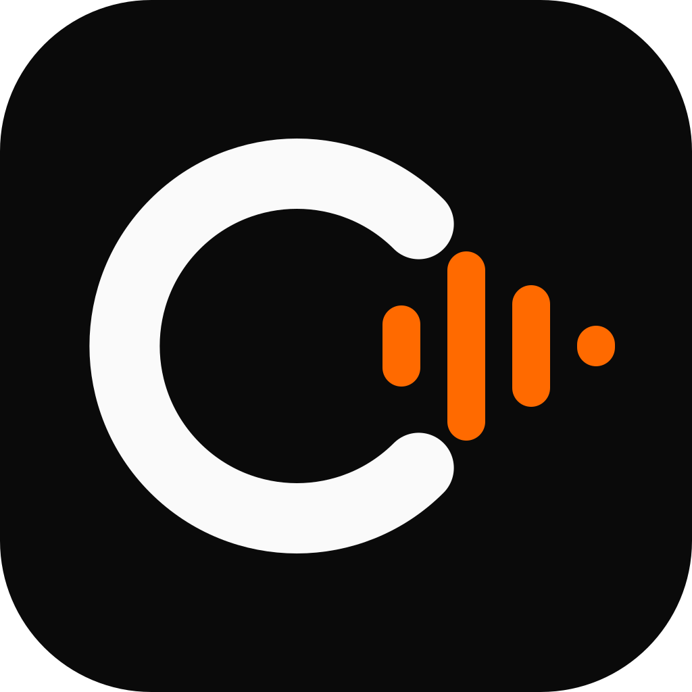

<div align="center">
  
  <h1>CallenVoice</h1>
  <p><strong>Doblaje y localización de videos con IA, en tu propia computadora.</strong></p>
  <p>
    <a href="LICENSE"></a>
    
  </p>
</div>

CallenVoice es una aplicación de escritorio para Windows que traduce y dobla videos
con voces sintéticas. Funciona en la computadora del usuario: el audio, los videos y
las voces no se suben a ningún servidor.

Es una **versión modificada de [VoiceStudio](https://github.com/debpalash/VoiceStudio)**
(© 2024-present Palash Debnath y colaboradores de VoiceStudio), distribuida bajo la
misma licencia, AGPL-3.0. El aviso de modificación completo está en
[CALLENVOICE.md](CALLENVOICE.md).

> [!IMPORTANT]
> **Estado: en desarrollo.** Todavía no hay instalador publicado. La app se puede
> ejecutar desde el código fuente (ver abajo). Las secciones de este documento que
> dicen *planificado* describen trabajo que aún no está hecho.

## Qué hace

- **Doblaje de videos:** transcribe el audio original, traduce el texto y genera la
  nueva pista de voz, con un editor para revisar cada frase antes de exportar.
  Este flujo viene de VoiceStudio.
- **Todo local:** los modelos de IA se descargan una vez y corren en la computadora.
  La app pide permiso antes de descargar cada modelo.
- **Solo modelos con uso comercial permitido:** CallenVoice ofrece únicamente los
  modelos de su lista blanca ([`backend/callen/catalog.py`](backend/callen/catalog.py)).
  Los modelos de VoiceStudio con licencias no comerciales están excluidos.
- **Voz por defecto:** MOSS-TTS-Nano (Apache-2.0), pensada para funcionar sin GPU.

### Planificado

- Traducción local con Opus-MT (Apache-2.0), integrada en la app.
- Perfiles de idioma: español latinoamericano, de Argentina y de México, y portugués
  de Brasil.
- Clonación de voz **solo con autorización y consentimiento** de la persona cuya voz
  se usa.
- Instalador para Windows con actualizaciones automáticas.

## Requisitos

| | Mínimo | Recomendado |
| --- | --- | --- |
| Sistema | Windows 10/11 de 64 bits | Windows 11 |
| Memoria | 8 GB de RAM | 16 GB de RAM |
| Procesador | CPU x86-64 (no requiere GPU) | CPU de 6 núcleos o más |
| GPU | No necesaria | NVIDIA, como aceleración opcional |
| Disco | Espacio para los modelos que descargues | SSD |

Con el mínimo, el doblaje funciona pero es lento: en una prueba con 2 núcleos y 8 GB,
la voz por defecto tardó unas 2 veces la duración del audio generado.

## Ejecutar desde el código fuente

Requisitos: [Git](https://git-scm.com/), [Bun](https://bun.sh/) y
[uv](https://docs.astral.sh/uv/).

```bash
git clone https://github.com/cellangamer978-sudo/CallenVoice.git
cd CallenVoice
bun run dev
```

`bun run dev` instala las dependencias de JavaScript y, si hace falta, el entorno de
Python del backend, y abre la app. Es el método heredado de VoiceStudio; detalles en
[electron/README.md](electron/README.md).

> [!NOTE]
> Todavía no verificamos la compilación del instalador de Windows. Hasta entonces, la
> ejecución desde el código es la única forma soportada.

## Código fuente y licencia

CallenVoice es software libre bajo la
[GNU Affero General Public License v3.0](LICENSE) (AGPL-3.0-only).

- Cualquier persona que reciba CallenVoice tiene derecho al código fuente completo
  de la versión que recibió. Este repositorio es ese código, y la app lo enlaza en
  Configuración → Acerca de.
- Los créditos y el aviso de licencia de VoiceStudio se conservan sin cambios en
  [LICENSE-NOTICE.md](LICENSE-NOTICE.md).
- Las dependencias y los modelos de IA tienen sus propias licencias:
  [THIRD_PARTY_NOTICES.md](THIRD_PARTY_NOTICES.md).
- Cada archivo de VoiceStudio que modificamos, y por qué, está registrado en
  [docs/callen/cambios-al-original.md](docs/callen/cambios-al-original.md).
- Las decisiones técnicas están en [docs/callen/decisiones/](docs/callen/decisiones/).

"VoiceStudio" es el nombre del proyecto original y aparece aquí solo para darle
crédito. CallenVoice no está afiliado ni respaldado por los mantenedores de VoiceStudio.

## Uso responsable

No uses CallenVoice para imitar la voz de alguien sin su permiso, ni para engañar,
suplantar identidades o difundir desinformación. Quien usa la herramienta es
responsable del contenido que genera y de contar con los derechos sobre los videos y
las voces que procesa.

## Documentación técnica

La carpeta [docs/](docs/) conserva la documentación de VoiceStudio, que en su mayor
parte sigue siendo válida para CallenVoice; el inventario completo de funciones heredadas
está en el [catálogo de funciones](docs/feature-catalog.md) (en inglés, e incluye
secciones que CallenVoice oculta). La documentación propia está en
[docs/callen/](docs/callen/).
